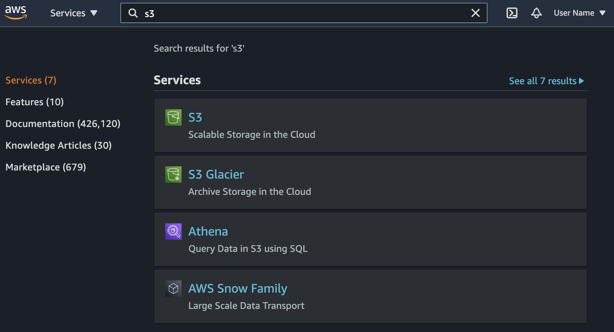
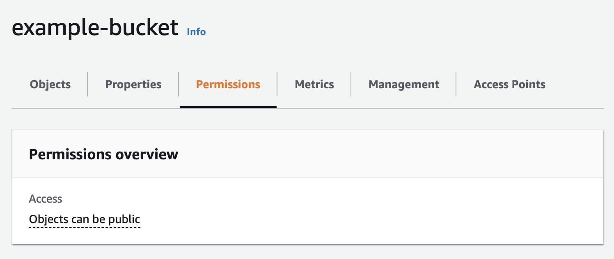
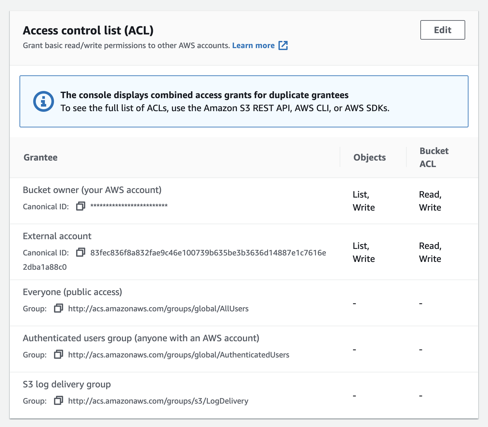
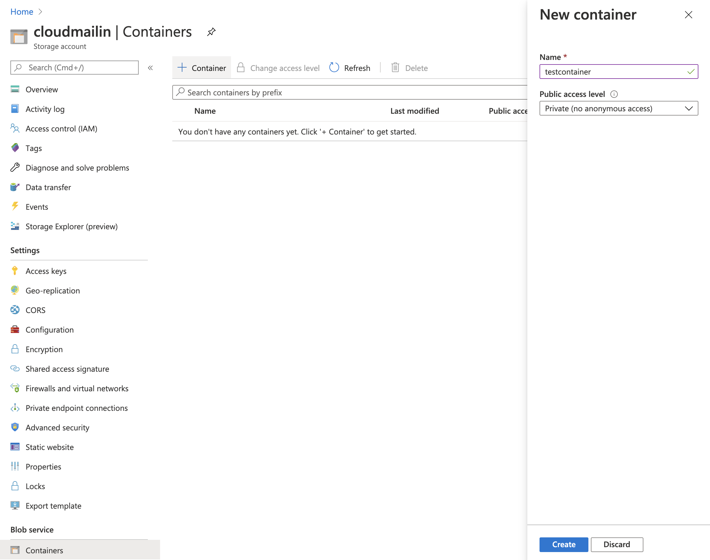
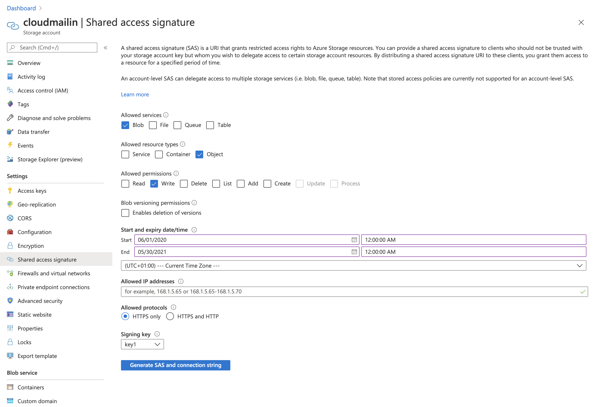
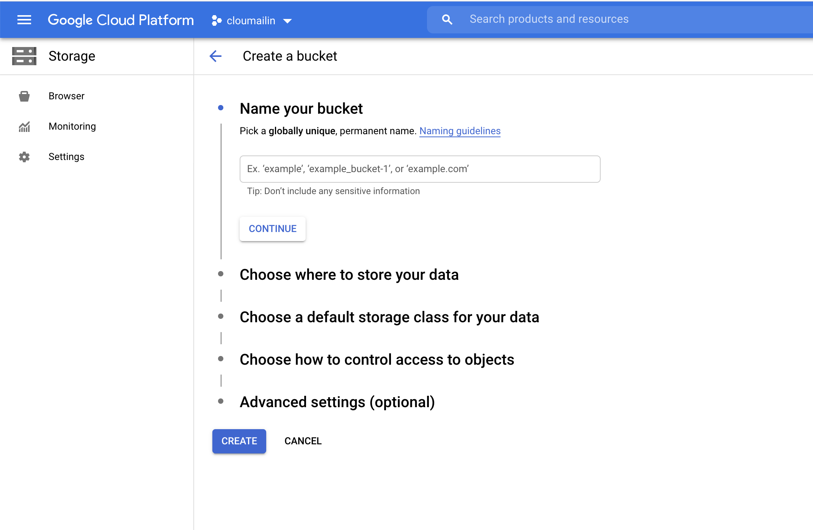
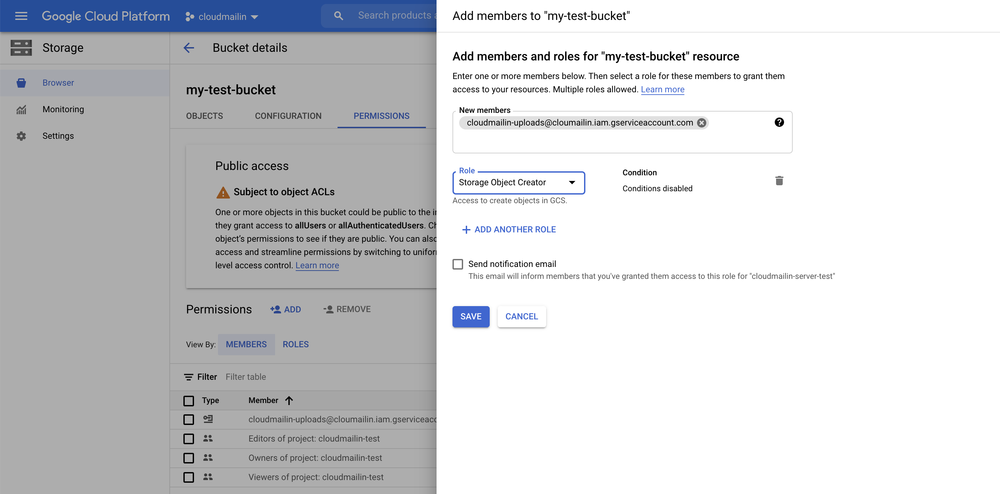

# Full Email Storage / Backup API for AWS S3, Google Cloud Storage, Azure Blob

CloudMailin allows you to receive any volume of email over HTTP via HTTP POST
Webhook. For some time it has been possible to offload the sending of email
attachments to Cloud Storage such as Amazon Web Services (AWS) S3, Google Cloud
Platform Storage or Azure Blob Storage.

It's also possible to send the entire email to CloudStorage, opening up new
possibilities for your HTTP server to process inbound emails.

You can send the full email to:

* [Amazon Web Services (AWS) S3]
* [Microsoft Azure Blob Storage]
* [Google Cloud Platform Cloud Storage]

## Why send email directly to Cloud Storage?

Sending your full email, rather than just the email attachments to AWS S3,
Google Cloud Storage or Azure Blob Storage opens new possibilities for receiving
inbound emails via Webhook. You could process the email asynchronously, use the
system as a backup or work more effectively with serverless functions for
example.

### Email storage formats

There are two formats available for full email storage raw and parsed JSON:

| Format | Description                                          |
|--------|------------------------------------------------------|
| `RAW`  | The original, unparsed email with headers and body.
| `JSON` | A fully parsed email in JSON format. This format is the same as the [JSON format] sent to your Webhook.

## Send the full email to AWS S3

Once you have enabled the feature you setup the Full Message storage in a very
similar way to setting up attachment storage.

### Grant CloudMailin permission send email to your AWS S3 Bucket

There are several ways that you can grant permission for CloudMailin to create
files in your S3 Bucket. The simplest is to use the AWS website.

1. Go to the AWS Management Console
   [https://console.aws.amazon.com](https://console.aws.amazon.com) and Sign in.
2. Click on the S3 Tab, then select your bucket (or create a new one)
    
3. Click on permissions the button
    
4. Scroll down to the Access control list (ACL) panel
    
5. Click `Edit` and then `Add grantee`
    
6. In the `grantee` field from above, paste the CloudMailin Canonical ID,
    choose `write` and then save

> AWS Canonical ID: `83fec836f8a832fae9c46e100739b635be3b3636d14887e1c7616e2dba1a88c0`

You should now have granted CloudMailin permission to add files to your S3
bucket. You can now [Setup CloudMailin] to receive the emails in its Webhook.

## Send the full email to Azure Blob Storage

It's possible to configure CloudMailin to send the full email directly to an
Azure Blob Storage container. CloudMailin writes to the container using a
Shared Access Signature (SAS) URL that you generate, so we never need your
storage account keys.

### Grant CloudMailin permission to send email to your Azure Container

1. Create a new `Container` in the Blob service panel of your Azure Storage
   Account (or choose an existing one).
   
2. Go to Settings and then `Shared Access Signature` (SAS).
3. Generate a SAS URL for the `Blob` service with `Object` and `Write`
   permission and select the start and end dates for the signature. You'll need
   a large enough date range to provide CloudMailin continued access to the
   container.
   
4. Once you've generated the URL save a copy of the full `SAS URL`. CloudMailin
   needs the whole URL, not just the SAS token.

> Be sure to select a large enough date range for continued use with
> CloudMailin.

You should now have granted CloudMailin permission to add files to your Azure
Blob Storage container. You can now [Setup CloudMailin] to receive the emails
in its Webhook.

## Send the full email to Google Cloud Storage

It's possible to configure CloudMailin to send the full email directly to a
Google Cloud Storage bucket. You grant the CloudMailin upload service account
permission to create objects in your bucket, so there are no credentials to
share with us.

### Grant CloudMailin permission to send email to your Google Cloud Storage Bucket

1. Head to the Google Cloud Platform management page and go to Storage.
2. Create a new `Bucket` or edit your existing bucket.
   
3. Click on the `Permissions Tab` and select `Add` to add a member to the
   permissions tab.
4. Grant the CloudMailin Service Account (below) `Storage Object Creator`
   permission to allow the creation of new Storage Objects.
   

> The CloudMailin service account that you need to grant permission is:
> `uploads@cloudmailin-uploads.iam.gserviceaccount.com`

You should now have granted CloudMailin permission to add files to your Google
Cloud Storage bucket. You can now [Setup CloudMailin] to receive the emails in
its Webhook.

## Setup CloudMailin to Send Emails to Cloud Storage

Now that you've added the permission to upload emails head to CloudMailin and
enable the feature.

1. Log into your [Address Dashboard] and choose the address you wish to manage.
2. Select `Add full message storage` and choose your storage provider.
3. Enter the details for the provider you set up above:
   * For AWS S3 enter your bucket name and an optional path prefix to place
     before each file name (in the format `bucket_name/path_prefix`). You'll
     also need to add your S3 bucket region and select the permission to apply
     to files when they are created. We recommend using
     `Bucket owner full control` here.
   * For Azure Storage enter the full `SAS URL` you generated above and the
     name of the container. CloudMailin extracts the storage account domain
     and SAS token from the URL.
   * For Google Cloud Storage enter your bucket name and an optional path
     prefix to place before each file name (in the format
     `bucket_name/path_prefix`).
4. Finally, you'll need to select the [Format].

When you save, CloudMailin writes a small test file to your storage to check
that the permissions are correct. If the test fails the settings are not saved
and the form will show which field needs attention.

Now when your emails are received you'll still get the regular Webhook but your
HTTP POST will also include the `store_url` parameter in the `envelope`. For
example the JSON format will look like the following:

```jsonc
"envelope": {
  "to": "to@example.com",
  "from": "from@example.com",
  "helo_domain": "localhost",
  // ...
  "store_url": "https://example.s3.amazonaws.com/2021_12_01_00_00_00_a8ed6a3f7aeb93ce726b9dd2dea9eb53.eml"
}
```

For more detail relating to the store_url see the
[HTTP Post Formats](/http_post_formats/) documentation.

[Setup CloudMailin]: #setup-cloudmailin-to-send-emails-to-cloud-storage
[Format]: #email-storage-formats
[Amazon Web Services (AWS) S3]: #send-the-full-email-to-aws-s3
[address dashboard]: https://www.cloudmailin.com/addresses
[Microsoft Azure Blob Storage]: #send-the-full-email-to-azure-blob-storage
[Google Cloud Platform Cloud Storage]: #send-the-full-email-to-google-cloud-storage
[JSON format]: /http_post_formats/json_normalized/
